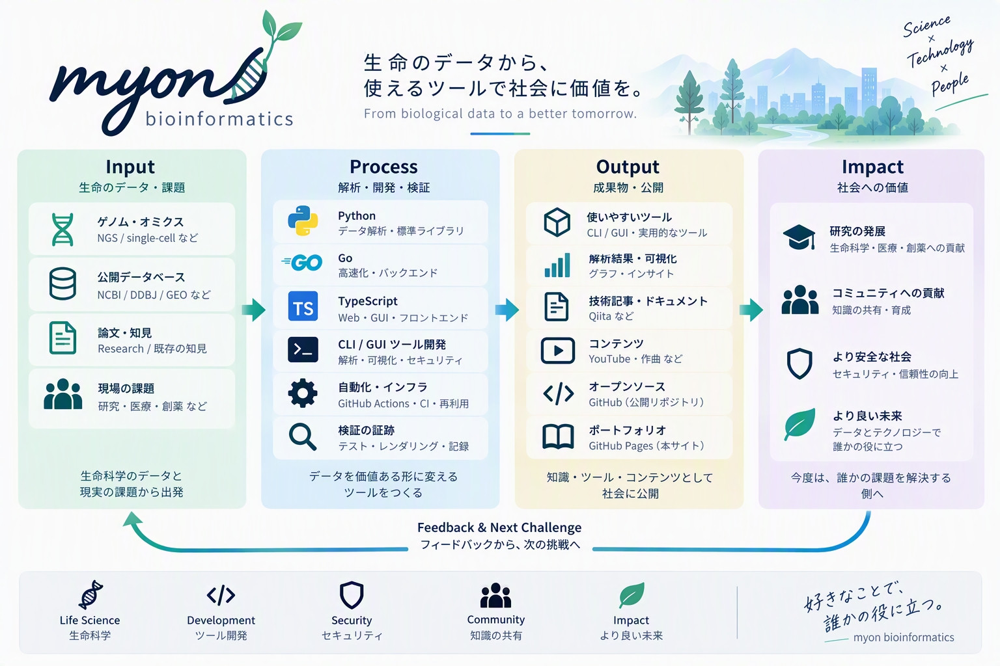

<!-- PRESENTATION:START title -->

  

<h1 align="center">🐍 myon-bioinformatics 🎸</h1>

  <a href="./assets/brand/">Brand assets</a> · <a href="./assets/brand/favicon.png">Favicon (PNG)</a> · <a href="./assets/brand/favicon.ico">Favicon (ICO)</a>

<!-- PRESENTATION:END title -->

<!-- HEADER:START -->

  Security × Backend × Data • Python / Node.js / Dart (Flutter)

  <a href="https://lit.link/myon123">lit.link</a> •
  <a href="https://linktr.ee/myon123">Linktree</a> •
  <a href="https://myon-bioinformatics.github.io/">Portfolio (GitHub Pages)</a>

<!-- HEADER:END -->

<!-- PRESENTATION:START badges -->

  
  

  
  

<!-- PRESENTATION:END badges -->

---

<!-- PROFILE:START -->
> **Canonical source:** [profile.json](https://github.com/myon-bioinformatics/myon-bioinformatics.github.io/blob/main/profile.json)
> This section is generated automatically. Edit the canonical JSON instead of this README block.

## 👋 Summary / 自己紹介

Bioinformatics → Security / Backend engineer.  
I design and build practical CLI and browser tools: mostly single-file, standard-library Python, with Node.js for JavaScript libraries and Dart/Flutter for multi-platform apps. Each tool is verified in CI (cross-browser tests, JUnit evidence) and shared across repositories. My background spans genomic data pipelines, network security tooling, and developer productivity utilities.

> _“I build practical tools and templates you can run today.”_

## 🧭 Career Flow

- **2020 — Started Bioinformatics**: Began working with genomic data pipelines and sequence analysis tools.
- **2021 — Python GUI Tooling**: Built beginner-friendly GUI wrappers for network security tools (Nmap, Scapy).
- **2022 — Security / Backend Focus**: Shifted focus toward security tooling and backend service development.
- **2023 — Multi-language Engineering**: Expanding into Go and TypeScript for backend APIs and developer tooling.
- **2026– — Single-file Tools & Verified Workflows**: Building standard-library Python tools shared across repositories, cross-browser and Flutter Web verification in CI, LLM/MCP tool-call experiments, and question-driven baseball data analysis.

## 🧰 Skills

### Languages
- Python (90%)
- Go (65%)
- TypeScript (60%)
- Bash (70%)

### Domain
- Bioinformatics (85%)
- Network Security (75%)
- Backend / API (65%)
- GUI / Desktop (80%)

### Tools & Infra
- Linux / CLI (85%)
- Docker (60%)
- Git / GitHub (80%)
- Wireshark / Scapy / Ghidra (70%)
- Flutter / Dart (60%)

## 🧑‍💻 What I’m Working On

- Single-file, standard-library Python tools shared across repositories (gh_identity, xprobe, yourself, cli_args, markdown)
- Question-driven baseball data analysis (Aoi and its subprojects)
- Cross-browser and Flutter Web verification with Playwright and CI evidence (browser-test-kit, flutter_navigation_basic)
- LLM / MCP tool-call experiments (mcp-toolcall-lab) and document conversion (Ironmate)
- DNA / protein sequence search and analysis (search_seq_including_spaces)

## 📫 Contact

[Portfolio](https://myon-bioinformatics.github.io/) • [GitHub](https://github.com/myon-bioinformatics) • [Twitter](https://twitter.com/myonitbusiness) • [lit.link](https://lit.link/myon123) • [Linktree](https://linktr.ee/myon123)
<!-- PROFILE:END -->

---

<!-- PRESENTATION:START concept -->
## Activity overview

A diagram summarizing the flow of activity and the value it aims for. "This site" in the diagram refers to the [portfolio](https://myon-bioinformatics.github.io/). Click the image to enlarge it.
<!-- PRESENTATION:END concept -->

---

<!-- PROJECTS:START -->
## 📦 Featured Repositories

> **Selection source:** [projects.json](https://github.com/myon-bioinformatics/myon-bioinformatics.github.io/blob/main/projects.json) · **Repository facts:** [api/repos.json](https://myon-bioinformatics.github.io/api/repos.json)

### [search_seq_including_spaces](https://github.com/myon-bioinformatics/search_seq_including_spaces)

Standard-library Python CLI for DNA and protein sequences: finds patterns whose front and back are fixed while the spacer in between varies, and writes CSV/JSONL. Also reads FASTA/FASTQ/GenBank, compares and translates sequences, gives RNA-fold and protein hints, and fetches from NCBI/PDB. CI-tested on Python 3.10–3.14.

`bioinformatics` `dna` `protein` `cli`

### [Aoi](https://github.com/myon-bioinformatics/Aoi)

Baseball (NPB) research framework that looks for better questions rather than answers: starting from unexplained long-term outcomes, it observes, measures and tests the limits of models, metrics and evaluation. Parent of the six research subprojects below (git subtree).

`baseball` `research` `statistics`

### [QueRyu](https://github.com/myon-bioinformatics/QueRyu)

Reproducible, polite fetching of NPB pages with conditional-GET caching and provenance, used to build observation datasets for Aoi.

`baseball` `data-acquisition` `reproducibility`

### [BlueProbe](https://github.com/myon-bioinformatics/BlueProbe)

Observes and extracts the HTML/CSS/DOM structure of NPB pages before any interpretation (observe first, interpret later).

`baseball` `html` `data-extraction`

### [SakAnalytics](https://github.com/myon-bioinformatics/SakAnalytics)

Team-season metrics, remaining-game and clinch magic-number simulation, and synthetic-league experiments from NPB game records.

`baseball` `simulation` `statistics`

### [PythDRagoras](https://github.com/myon-bioinformatics/PythDRagoras)

Treats explanations as propositions and tests them against counterexamples, with rule search and sensitivity analysis for NPB outcomes.

`baseball` `hypothesis-testing` `rule-search`

### [DRAgoWing](https://github.com/myon-bioinformatics/DRAgoWing)

Renders research records as Plotly.js HTML reports and proposition tables, with optional headless-Chrome PNG/SVG export and no Python plotting libraries.

`baseball` `visualization` `plotly`

### [NagoyAction](https://github.com/myon-bioinformatics/NagoyAction)

Defines a research pipeline once in TOML and runs it with the same standard-library command locally and on GitHub Actions, with run receipts, Markdown link checks and publication gates.

`pipeline` `github-actions` `reproducibility`

### [gh_identity](https://github.com/myon-bioinformatics/gh_identity)

Single-file, standard-library Python interface over the GitHub CLI for observing repositories, pull requests, checks and workflow runs, with explicit identity and bounded output.

`github` `cli` `single-file`

### [xprobe](https://github.com/myon-bioinformatics/xprobe)

Single-file, standard-library toolkit for text search, boundary-case probing and failure-oriented test support, including convention-driven discovery of files and production symbols.

`testing` `cli` `single-file`

### [yourself](https://github.com/myon-bioinformatics/yourself)

Single-file, standard-library tool that reports host, OS and runtime facts read-only, as concise copyable text for troubleshooting and AI context.

`diagnostics` `cli` `single-file`

### [cli_args](https://github.com/myon-bioinformatics/cli_args)

Single-file, standard-library toolkit for reusable CLI argument definitions, validation, command construction, execution and JSON/text output.

`cli` `validation` `single-file`

### [markdown](https://github.com/myon-bioinformatics/markdown)

Lightweight, function-focused Markdown utilities built with the Python standard library only.

`markdown` `library` `single-file`

### [ascii_artist](https://github.com/myon-bioinformatics/ascii_artist)

Python utilities for ASCII art generation, conversion, layout and text-based diagrams. CI-tested on Python 3.10–3.14.

`ascii-art` `diagram` `single-file`

### [Err-o-RoadRunner](https://github.com/myon-bioinformatics/Err-o-RoadRunner)

Error-triggered triage for Python, Node and CI failures: does nothing until something fails, then prints FOUND / NOT FOUND / HINT reports. Python standard library only.

`debugging` `ci` `cli`

### [nvd_nist_known_vulns](https://github.com/myon-bioinformatics/nvd_nist_known_vulns)

Single-file, standard-library client for the NVD CVE API 2.0: fetches known vulnerabilities for CPE 2.3 names and emits deterministic JSON Lines. CI-tested on Python 3.9–3.14.

`security` `cve` `cli`

### [browser-test-kit](https://github.com/myon-bioinformatics/browser-test-kit)

Cross-browser testing reference kit: Playwright Node and Python lanes on Chromium, Firefox and WebKit (desktop and mobile), screenshot evidence and OS/browser matrices on GitHub Actions, plus standard-library engineering utilities.

`playwright` `cross-browser` `testing`

### [web-ui](https://github.com/myon-bioinformatics/web-ui)

Shared, build-free CSS themes, UI components and small JavaScript utilities for the static pages of these projects, including layout presets that switch without reloading.

`css` `ui-components` `static-site`

### [flutter_navigation_basic](https://github.com/myon-bioinformatics/flutter_navigation_basic)

Multi-platform Flutter app (Web, iOS, Android, macOS) with 198 routed screens on a reusable foundation (themes, routes, shared widgets, URL parameters); the Flutter Web build is published on GitHub Pages and checked with Playwright screenshots.

`flutter` `dart` `multi-platform`

### [mcp-toolcall-lab](https://github.com/myon-bioinformatics/mcp-toolcall-lab)

Reproducible experiments on how LLMs discover and call MCP tools: a FastMCP server with deterministic mock tools, Open WebUI and LibreChat as clients under test, protocol tests and an anti-pattern catalog.

`llm` `mcp` `open-webui`

### [Ironmate](https://github.com/myon-bioinformatics/Ironmate)

Python toolkit for converting documents and images: a Markdown-to-PPTX pipeline, text and color editing of existing PPTX, browser-based Image Studio and Slide Studio, and pixel-grid art prototypes.

`pptx` `markdown` `image`

🔎 More repos

* [AttentionToJapaneseBeginners](https://github.com/myon-bioinformatics/AttentionToJapaneseBeginners)
* [audio_any2any_gui](https://github.com/myon-bioinformatics/audio_any2any_gui)
* [convert_img_fmt_to_webp-CUI-](https://github.com/myon-bioinformatics/convert_img_fmt_to_webp-CUI-)
* [convert_img_fmt_to_webp-GUI-](https://github.com/myon-bioinformatics/convert_img_fmt_to_webp-GUI-)
* [cumlative_usage](https://github.com/myon-bioinformatics/cumlative_usage)
* [GitHub_api_Template](https://github.com/myon-bioinformatics/GitHub_api_Template)
* [HelpYouBuildServer](https://github.com/myon-bioinformatics/HelpYouBuildServer)
* [image_ext_converter_gui](https://github.com/myon-bioinformatics/image_ext_converter_gui)
* [LINENotifyAPI_Template](https://github.com/myon-bioinformatics/LINENotifyAPI_Template)
* [mock_server_JS](https://github.com/myon-bioinformatics/mock_server_JS)
* [myon-bioinformatics.github.io](https://github.com/myon-bioinformatics/myon-bioinformatics.github.io)
* [niconicoSearchAPI_Template](https://github.com/myon-bioinformatics/niconicoSearchAPI_Template)
* [oci-cost-analysis](https://github.com/myon-bioinformatics/oci-cost-analysis)
* [python3nmap_GUI_for_Beginners](https://github.com/myon-bioinformatics/python3nmap_GUI_for_Beginners)
* [Qiita_API_Template](https://github.com/myon-bioinformatics/Qiita_API_Template)
* [scapy_GUI_for_Beginners](https://github.com/myon-bioinformatics/scapy_GUI_for_Beginners)
* [TalkCompress](https://github.com/myon-bioinformatics/TalkCompress)
* [video_to_image_gui](https://github.com/myon-bioinformatics/video_to_image_gui)
* [video2audio_gui](https://github.com/myon-bioinformatics/video2audio_gui)
* [vlm_ocr_jp_gui](https://github.com/myon-bioinformatics/vlm_ocr_jp_gui)

<!-- PROJECTS:END -->

---

<!-- PRESENTATION:START stats -->
## 📊 Stats

  

  

<!-- PRESENTATION:END stats -->

---

<!-- FOOTER:START -->
## ℹ️ More about me

😏 **詳細はこちら** → <a href="https://myon-bioinformatics.github.io/">myon-bioinformatics.github.io</a>
<!-- FOOTER:END -->

---

## Shared GitHub operations

`gh_ops.py` is the canonical stdlib-only GitHub operation CLI migrated from
browser-test-kit, with its unit/parity tests owned here. See [the contract](docs/gh-ops.md).
Consumers enroll the source/LICENSE via `vendor_sync` and keep only integration
checks, rather than maintain generic operation implementations or duplicate tests.

For coordinated changes across repositories, `fleet-apply --manifest fleet.json`
groups files per repository, reuses existing PRs and verifies explicitly listed
source PRs before commenting/closing them. `pr-edit --append-body-file` updates
metadata without discarding existing text; `git-push` sends an existing commit
with destination readback. See [the operation guide](docs/gh-ops.md).

## Shared tooling and evidence

[Immutable checkout verification](docs/verify-checkout.md) reuses post-merge
ancestry checks and ordered test commands across repositories, recording the
tested commit/tree in a JSON receipt from a disposable detached worktree.

This repository also owns reusable CI workflows and stdlib-only tooling for
sibling repositories. It is both the profile README and the parent tooling repo.

| Capability | Entry point / contract | Consumer responsibility |
| --- | --- | --- |
| Git inspection | [git_inspector.py](git_inspector.py), [contract](docs/git-inspector.md) | Request observations; keep repository-specific presentation local |
| Vendor placement and artifact staging | [vendor_sync.py](vendor_sync.py), [vendor_stage.py](vendor_stage.py), [guide](docs/vendor-automation.md) | Enroll exact source/LICENSE bytes and an explicit lock; use the parent stager |
| GitHub workflow operations | [gh_workflow.py](gh_workflow.py), [guide](docs/gh-workflow.md) | Keep explicit write preconditions and repository-specific orchestration |
| JUnit failure identity | [reusable collector](.github/workflows/reusable-junit-identity.yml), [contract](docs/junit-identity.md) | Produce raw XML, preserve the test exit code, and configure exact expected report paths |
| Browser screenshot evidence | [browser_evidence.py](browser_evidence.py), [contract](docs/browser-evidence.md) | Capture screenshots with the consumer's engine runner; supply run and checkout identity |
| Third-party browser JS (`js-adopt`) | [js_adopt.py](js_adopt.py), [guide](docs/js-adopt.md) | Keep `js.lock.json` (raw GitHub URL or exact npm release, sha256, SRI, license) and check it in CI; verify the page in each engine |
| Concise test runner (`pytest-brief`) | [pytest_brief.py](pytest_brief.py), [contract](docs/pytest-brief.md) | Resolve missing dependencies and run pytest with filtered summary output |
| TypeScript compiler policy | [policy](docs/typescript-native-policy.md) | Policy only; pin a compatible stable release and validate each consumer at the same head |

The [Python runtime/setup policy](docs/python-ci-policy.md) separates stdlib runtime
compatibility from development tooling and records the governed template boundary.

uv is the intended management path for these Python tools, including stdlib-only
single-file tools. A tool is not kept off uv because someone also runs the file
directly. When a standalone copy is what you want, copy the file from the GitHub repo
(the repository and source path in `vendor-catalog.json`). Environments
where uv does not apply, such as `python -S` or Python 3.9, are skipped with a
reason. See [the migration note](docs/uv-git-source-migration.md).

The parent's [Python tests workflow](.github/workflows/python-tests.yml) collects
JUnit from four development/test Python versions (3.11–3.14) and three
vendor-portability jobs (Linux 3.11, Windows 3.12, macOS 3.12). A separate
stdlib-only runtime smoke job runs `tests/stdlib_runtime_smoke.py` with `python -S`
on Python 3.9 and 3.10, without installing pytest. Raw XML and compact failure identity are
separate artifacts: raw XML is retained for 14 days, while compact artifacts use
repository-default retention. A complete collection does not turn a
failed producer job green, and a green run may have an empty failure corpus.

Browser evidence currently provides a **contract only**. Shared Playwright and
Stagehand execution adapters are not implemented here yet; consumer capture
runners must remain until their replacement is verified. Repository metadata's
contract/generator pair is still maintained in
[Ironmate](https://github.com/myon-bioinformatics/Ironmate).

The organization-wide target survey is in [docs/vendor-target-inventory.json](docs/vendor-target-inventory.json).
Single-file candidates are catalogued even when they require an explicit skip:
`default_enrollment` records a machine-readable default for every consumer;
individual `consumers` entries override it. When absent, the original
`default_single_file_policy` enrollment remains unchanged. Archived applications,
external-package applications and parent-managed vendor tools are not implicitly
placed into consumer trees. See [catalog coverage](docs/vendor-catalog-coverage.md).

## Discover production entry points

[Convention-driven file and symbol discovery](docs/convention-discovery.md) gives verified one-liners for this repository. Supply filename/name rules to inspect production code, configuration and workflows with the shared stdlib-only xprobe tool.

[Cross-repository use cases and connection candidates](docs/cross-repository-use-cases.md) records the entry points and verification status of the 23 public, non-archived repositories.

Local prerequisite observations: `python -S preflight.py --root . --require git
--python-min 3.11`. Optional `--runtime-facts` connects yourself's OS/runtime JSON
without importing another checkout; see [preflight usage and limits](docs/preflight.md).
