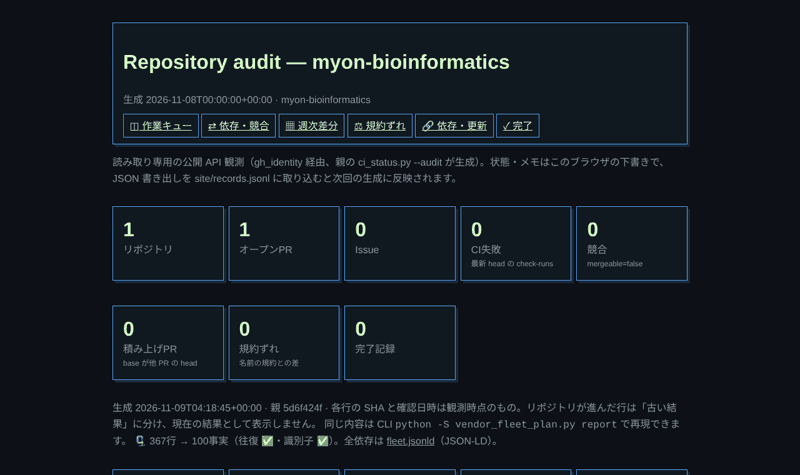
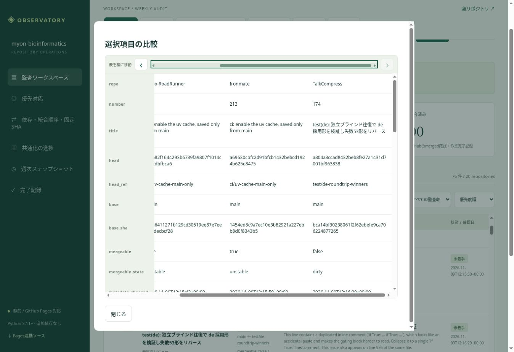

# 親リポジトリの監査Pages

公開先は https://myon-bioinformatics.github.io/myon-bioinformatics/ 。ポートフォリオのPagesは変更しません。

## 配置と自動更新

`.github/workflows/pages.yml` は関連ファイルのmain push、毎日06:17 JST、workflow_dispatchで検証後に `python3 -S tools/build_audit_pages.py` を実行し、共通Pages workflowから `site/dist` を公開します。スケジュールはGitHub側で遅延する場合があります。初回はリポジトリの Settings → Pages → Source を **GitHub Actions** に設定します。GITHUB_TOKENでのPages初期有効化はGitHub側で許可されないため、管理設定を自動的に変更する処理やPATの追加は行いません。

PRではPython標準unittestとNode 26の組込みテストを実行します。同一リポジトリのPRのみ、公開2リポジトリ（cli_args,xprobe）の実データで読み取り専用のビルドを追加検証します。PRからPages公開は行いません。実行時はUbuntu 24.04標準のPython 3.11以上を使用し、追加のpip/npm依存は不要です。公開jobにのみpages/id-token権限を与え、データ収集に使うGH_TOKENはGITHUB_TOKENを環境変数で渡します。GitHubトークンをブラウザへ送信しません。

## データと失敗時の動作

提供元は既存の `ci_status.py` / vendored `gh_identity.py`。公開・非archived・指定ownerのリポジトリだけを列挙し、open一覧、詳細時点のhead、そのSHAのcheck-runsとcommit statuses、未解決reviewThreadsを取得します。最後にheadとopen状態を再確認します。途中でhead/stateが変わった場合、一覧やレビューのページが欠落した場合、API制限・通信障害の場合は公開を止めます。CI自体が失敗しているPRは正常な観測結果として掲載します。

前回の `data.json` / `history.json` を公開先から読み、404だけを初回公開として許容します。403/429/5xx・壊れたJSON・サイズ超過は失敗します。失敗したビルドはPages artifactのupload/deployへ進まず、前回の公開内容を維持します。再実行はActionsから行えます。

同じビルドで `vendor_fleet_plan.py` の依存・更新レポート（対象検出、依存グラフ、更新計画、行ごとのSHAと確認日時、前回差分、残る対応）を `data.json` の `fleet` に入れ、`report.html` の「🔗 依存・更新」と作業画面の「共通化の進捗」に表示します。取得は匿名の公開cloneだけで、失敗しても監査の公開は止めず「取得不能」と表示し、古い結果を現在の結果として出しません。残る対応は同じ事実を1件にまとめ、`FLEET-n` の番号を同じ事実に付け続けます。全依存（ノード・関係・出典）は同じ場所の `fleet.jsonld`（JSON-LD）にあります。



`index.html` は `tools/build_audit_pages.py` の `observatory_page()` がビルド時に組み立てる操作画面（手書きの `site/ui/index.html` は無し。ナビ・操作・絞り込みの一覧は同ファイルの `VIEWS` / `ACTIONS` / `FILTERS` に1回だけ書く）で、「統合後の確認」の表は同じく Python の `integration_summary()` がビルド時に書き（読む人の作業記録に依らない観測値なので JS では描かない）、配色は `<body data-ui-theme>` が指す PySaiyanWeBoo のトークンテーマ（既定 `green`、`style.css` は `--ui-*` を読むだけ）、`report.html` は共通web_uiヘルパーによる生成レポートです。すべて相対参照なのでプロジェクトPagesのサブパスでも動作します。最新head、観測日時、CI失敗のcheck名とURLを表示します。再読込ボタンは公開済みJSONを読むもので、GitHub Actionsの新規実行を起動するものではありません。

## 共通スクロール操作

PSWBの採用済み `vendor/web_ui.py` の `css_source('tokens.css')`（配色トークン）と `css_source('shell.css')` から、
ビルド時に `pswb-shell.css` を生成します。`ui-shell-scroll` を上部ナビ・操作列・
フッターナビ・表へ適用し、共通CSSを手書きで複製しません。生成物は
`pages-source.zip` にも同梱します。vendorの固定SHAやlockの変更は不要です。

横幅が足りない領域には左右ボタンとスクロールバーを表示します。
ヘッダーとフッターには同じ画面切替を置き、現在の画面を同期表示します。
フッターから切り替えると、監査結果へフォーカスと表示位置を移します。
表の上部バーと表本体の横位置は双方向に同期し、バー幅が異なっても右端が一致します。
長い表は画面高の64%までの領域内で縦にスクロールし、列見出しを固定表示します。
フィルタ・画面切替・比較ダイアログで再生成された表にも自動適用します。

各スクロール領域をTabで選び、左右矢印・Home・Endで移動できます。
テキスト入力やselect内部のキー操作は横取りせず、タッチ操作もネイティブのままです。
JavaScriptによる補助が動かない場合もCSSの横スクロールを利用できます。
ブラウザ用の追加パッケージ・CDN・GitHubへの書込みはありません。

確認済み: Chromiumで320 / 390 / 768pxのiframeとデスクトップ表示を使用し、
ページの横はみ出し、ヘッダー・フッターの右端到達、上下バーの右端一致、
固定見出し、比較ダイアログ、検索後の表の再生成、依存画面の3表を確認しました。
下の画像はプレビューで公開済みの2026-11-09観測JSONを読み込んだ証跡です。
ほかのブラウザ・実機のタッチ操作は未検証です。



## 週次記録と手入力

毎週最初の正常生成をISO週・JST基準で `history.json` に保存し、直近13週を次回公開へ引き継ぎます。同じ週の再実行ではその週の基準値を上書きしません。最新の一覧は毎回更新します。完了した項目がopen一覧から消えた場合、ブラウザの完了記録には前回の観測として残し、現行の作業キューには再混入させません。観測一覧からの消失はmerged/closedと断定しません。初回の週次履歴は1件です。

個人の状態・メモ・優先度・完了日・共通化進捗はブラウザのlocalStorageに保存し、観測JSONの更新で上書きしません。SitesとGitHub Pagesは別originのため、Sites画面で「記録を書出し」、Pages画面で「JSON読込」を行うと移行できます。端末間の移行も同じです。共通web_uiレポートのJSON形式は既存 `gh_ops.py records-import` で `site/records.jsonl` に取り込めます。共通化は証拠を確認して手動更新し、タイトルから抽出する監査軸を適合判定と混同しないでください。

## ローカル検証

```sh
python3 -S -m unittest discover -s tests -p test_ci_status.py
python3 -S -m unittest discover -s tests -p test_audit_pages.py
node --test tests/test_audit_model.cjs
node --check site/ui/app.js
# GH_TOKENを環境変数に設定した上で実データを検証する場合
python3 -S tools/build_audit_pages.py --repos cli_args,xprobe --previous '' --previous-history ''
# 依存・更新だけ（GitHub APIもトークンも不要）
python3 -S vendor_fleet_plan.py report --fetch --format markdown
```

全件の公開は `--repos` を指定せず行います。初回公開後はPages workflowの成功と `data.json` のgenerated_atを確認してください。

## 依存グラフと固定SHA監査

`graphlib.TopologicalSorter` を使用する。markdown.py のタスク検証と同じく、
未知ノードを先に検出する（graphlib の暗黙ノード追加を欠損と混同しない）。
Markdownの解析・Mermaid生成は持ち込まず、標準ライブラリを直接再利用する。

同一リポジトリの base/head 一致に加え、`site/dependencies.json` で
提供元→利用側→親の固定SHA更新を明示できる。依存はタイトルから推測しない。
例（説明用ID。実際の観測IDに置き換える）:

```json
{
  "edges": {"consumer#12": ["provider#34"]},
  "tasks": [{"id": "parent-pin-update", "kind": "pin-update", "depends_on": ["consumer#12"]}]
}
```

`dependency_plan` に決定的な推奨順序、代表的な循環経路、欠損参照、順序計算不能な
ノード（循環の下流を含む）、直接の統合待ちを保存する。欠損・循環の影響を
受けない独立した部分は順序を計算できる。ready は依存関係だけの判定で、
CI・レビュー・競合を許可する意味ではない。手入力のdoneはマージ証拠ではない。
設定ファイルによるmerged宣言は拒否する。統合済みPRはopen一覧から消えるため、
残った依存は欠損として表示する。次回監査時にGitHubのマージ証拠を確認し、
依存設定を整理する必要がある。自動的な統合済みPRの追跡は今回の範囲外。

Pagesビルド（strict監査）は各公開リポジトリのdefault branchをSHAへ解決し、
その不変リビジョンのルート `vendor.lock.json` を取得する。vendor-lock/1 の
files[].commit/ref（完全40桁SHA）と提供元のmain先端を比較し、match / different /
unknown を出す。ロックが404なら対象なし、通信失敗・非対応スキーマ等は確認不能。
mainがない場合も確認不能。取得失敗はpinのunknownとして残り、既存のPR・CI観測の
公開停止条件は変更しない。各レコードにlock_revisionを残す。子のロックも同じ処理。
ネストしたロック、pyprojectのGit依存、child-heads.jsonは今回自動収集しない。

不一致は「main先端と違う」だけで、祖先・分岐・互換性違反を意味しない。
互換性は常にnot_assessed。固定SHAの更新やvendorファイルの置換は行わない。
`dependencies.html` と生成レポートに表示し、操作画面からリンクする。
従来の優先度、手入力記録、13週の履歴保存はそのまま維持する。

検証:

```sh
python3 -S -m unittest discover -s tests -p test_ci_status.py
python3 -S -c "import unittest; r=unittest.TextTestRunner().run(unittest.TestLoader().discover('tests', pattern='test_ci_status.py')); raise SystemExit(not r.wasSuccessful())"
```

## 統合作業画面（2026-11-09）

SitesとPagesで `site/ui/` の同じ画面・データ境界を使用する。
CI失敗または未解決レビューのある項目は、手入力の優先度より先にP1表示する。
bugラベル・実競合をP2とし、タイトル中の「失敗」等をCI結果とは扱わない。
依存・統合順序・固定SHAタブでは、計算済み順序、直接の統合待ち、
循環・欠損と固定SHA/main先端の比較を表示する。
PR詳細の依存・競合・統合順序メモは観測された依存グラフとは別に保存する。
手入力の確認日は `noted_at`、GitHubの観測日時は `checked` とし、後者を編集しない。
完了記録は元の観測を保存し、一覧から消えた後も完了画面に残す。

前週差分は現在の観測と前週以前の最後の自動保存を比較し、
head・CI・レビュー件数・base・競合状態・タイトル・ラベルの変化を数える。
毎回変わる観測日時や個人メモだけでは更新に数えない。
前週基準がなければ比較不能と表示する。
最新main採用手順とpyproject共通化には、確認日・採用SHA・PRリンク・
残作業を記録する根拠欄を用意する。進捗は証拠を確認して入力する。

## Sitesの統合判断画面の反映

`site/ui/integration.js` と配布用 `site/ui/integration_plan.py` を共通UIとして使用する。
CI失敗・未解決レビュー・mergeable=falseは手入力の優先度より先にP1表示する。
同じリポジトリのPR変更パスを比較し、重複ファイルと共通workflowを列挙する。
重複パスは実際の内容競合を意味しない。変更パスは全ページ取得し、PR詳細の件数と
照合する。取得途中のhead・base SHA/ref変更やページ欠落は公開を止める。
最新headのCIはcheck-runsとcommit statusesを全ページ集計し、required checksの指定との
照合は未実施と明記する。base/head SHA、mergeable_state、取得日時を比較画面に表示する。

状態には保留・ブロッカー・統合済みを追加。再検証記録はhead/base両方が取得済みの
場合にのみ保存し、観測SHAが変われば「再検証必要」とする。証跡は手入力の確認記録であり、
GitHubへの書込み・CI起動・マージを意味しない。既存のfleetレポートと自動更新は維持する。

手入力した依存を計画へ反映するには「計算用JSONを書出し」とPythonスクリプトを取得し、
`python integration_plan.py integration-input.json --out integration-result.json` を実行して
結果をJSON読込する。Python 3.11+・標準ライブラリのみ。明示的な依存タスクも引き継ぐ。
closed未統合PRを明示依存した場合は欠損影響として扱い、merged PRは統合済みとして扱う。
GitHub観測と個人の判断記録を分離し、SitesからのJSON記録も同じ形式で読み込める。

## 統合後の確認

`data.json` の `integrations` は、open PRが0件のリポジトリも保持する。
既定ブランチの正確なSHA、check-runsとcommit statuses、確認日時、次の作業を表示する。
収集中に先端が動いた場合や取得失敗は「取得不能」とし、前回の成功で補わない。
CI成功は観測したチェックの成功であり、required checks充足や親の互換性を保証しない。
固定SHA・vendor参照の更新要否は未評価として残す。

マージ履歴は直近更新されたclosed PR最大30件から、既定ブランチへマージ済みのものだけを抽出する。
全履歴ではない。時刻・PR番号・マージコミットを保存し、実際のマージ順に並べる。
その順序を `graphlib` の依存辺に変換しない。ローカルテスト結果も推測しない。
この情報は既存の毎日のPages生成・週次スナップショットにも含まれる。

### 説明文の自動判定

固定SHAの参照は既存の `vendor_pins` と、観測した親mainのSHAに固定して取得した
`child-heads.json` から照合する。ビルド用PRブランチの台帳をmainの状態として扱わない。
一致・相違・観測不足を区別し、子CI成功時は参照更新候補、親CI待ち、親CI失敗などを定型文で表示する。
一致やCI成功だけで互換性・作業完了とは判定しない。未登録も更新不要とは判定しない。

任意の `site/integration-evidence.json` はリポジトリ名をキー、記録の配列を値とする。
各記録は完全な40桁 `sha`、`command`、`result`、文字列配列 `facts`、出典 `source` を持つ。
テスト実行側がこの形式を出力・保存すれば、説明文に機械的に反映される（AI不要）。
例: `{"Demo":[{"sha":"aaaaaaaaaaaaaaaaaaaaaaaaaaaaaaaaaaaaaaaa","command":"uv run pytest","result":"10 passed","facts":["往復ゲートはnlのみ"],"source":"CI artifact/test report"}]}`。
記録は報告値として表示するだけで、観測CIの判定を書き換えない。SHAが違う記録は過去の記録と明示する。
この変更では子リポジトリからの記録生成・親への自動送信までは実装していない。

## 利用導線と責務移管

別画面の `component-ops/` は、エラー調査から取得・抽出・分析・描画までの手順と移管判断を示します。表示は2026-11-11時点の確認に基づく静的な資料で、GitHubの最新状態を自動取得しません。公開時に `site/component-ops/` を同じPages artifactへコピーし、監査画面のサイドナビから参照します。更新時は根拠と確認日時を見直してください。


## GitHub検証証跡ビュー

`evidence.html` を監査画面から開く。Issue・PRのstatus sync、コメント、レビュー対象SHA、
head/main SHA、run/attempt/job、supersessionの記載、closureを同じ対象IDで確認する。
依存・競合・統合順序は既存画面を再利用する。検索、条件別フィルタ、時系列、比較、
確認順序、5状態の作業記録、次アクション、完了記録、週次差分、JSON保存・読込に対応する。

Pagesビルドは `tools/build_audit_pages.py` の証跡生成処理 で公開時の `parent-audit/1` と
`site/evidence/observations.json.gz`（公開リポジトリから取得済みの証跡）を結合する。
保存済み証跡の最新取得範囲はPSWB #134。全リポジトリのコメント・レビューや全attemptを
再取得する機能ではない。現在の公開在庫に含まれないリポジトリは出力しない。
生成した `evidence-data.json` は公開artifactのみへ出力し、取得済み入力と再生成コードは
Pagesソースアーカイブへ収録する。追加依存やworkflow権限の変更はない。

新しいheadの観測では過去CIを履歴として残し、現headのCIへ昇格させない。
実行日時がないcheckには観測日時のみを表示する。base SHAをmain SHAとして扱わず、
main以外の既定ブランチもmainと呼ばない。現行一覧からの消失、本文のsupersedes、
手入力の完了だけではGitHub closureを推定しない。マージ後成功は観測対象と
merge commitが完全一致する場合だけ記録する。CI成功はrequired checksの充足や承認を意味しない。

作業記録はoriginごとのlocalStorageに保存する。Sitesから移す場合は証跡ビューの
JSON書出し・読込を使用する。週次記録は最大8件の比較用要約を保持し、追加・更新・消失IDを表示する。
GitHubへの書込み、マージ、CI起動は行わない。取得範囲の不足は画面に明示する。


## 証跡ビューの継続運用

`evidence.html` の「集計・前回差分」はリポジトリ別の純Issue・open PR（Draft込み）を表示します。producerにrepository_countsがある場合だけAPI集計値を使用し、ない場合は監査一覧の件数とAPI未取得を区別します。前回値は保存済み証跡を基準にSHA・状態・マージ情報を比較し、消失をclosureとしません。

CIのhistorical・superseded・後続attemptを現行判定から除外し、レビューは同じ投稿者の最新状態を使用します。競合・未解決レビュー・CI失敗を優先表示。状態・期待SHA・次アクション・完了記録・週次記録は従来の端末内保存とJSON移行を維持します。承認証跡なしは承認必須の断定ではありません。


## 重複画面の整理

依存・統合順序は `index.html#dependencies` に統一しました。従来の `dependencies.html` は同じタブへの案内として残し、別の依存表を生成しません。作業状態は調査中・着手中・完了・保留・ブロッカーに統一し、既存の保存値は読込時に移行します。GitHubのopen/closedとは別です。

PSWB #134へ5状態の手順カードとフィルタを還元しました。採用先のvendor pin更新はPSWBのmain統合後に行います。証跡ビューはレビューSHA/run/attempt/job、運用ガイドは実行手順を扱うため、現段階では役割の異なる画面として維持します。監査のPR一覧・依存計算の複製は追加しません。


## 運用ページの責務整理

`workspace.html` は確認順序と各ページの入口です。依存・固定SHA・vendor参照は
既存の `index.html#dependencies` を再利用し、別の表を作りません。
`evidence.html` は既存の公開時生成 `evidence-data.json` を使用します。
ローカル確認用の固定スナップショットは新たに公開しません。

`operations.html` はREADME確認日とmain SHAを持つ9工程を案内します。
コマンドは未実行であり、READMEの期待出力と実測結果は区別します。
ErrorRoadRunnerのcheckout入口はtriage.py、配布入口はerroroadrunnerです。
BlueProbeのURL取得・cache生成とQueRyuの条件付き取得・cache履歴を区別します。
旧component-ops/は新ページへの案内です。

`records.html` が証跡・運用の手動完了記録と比較用週次記録を扱います。
両ページの保存先はmyon-workspace-v2、5状態と次アクションを共通化しました。
監査ビルドが生成する13週の観測履歴は従来どおりhistory.jsonに保持します。
旧originからはJSONで移行します。同originの旧記録移行は元データを削除せず、
既存IDを上書きしません。監査独自チェック・旧historyは元のJSONで保持します。
手入力の完了はGitHub closureやマージ許可、CI成功を意味しません。

workspace.js/CSSはPSWBへの還元候補です。PSWBのvendor pinや子リポジトリは
この変更では更新しません。Node 26・Python 3.11+・既存setup-uv方針を維持し、
追加のnpm/Python実行依存やworkflow権限はありません。
