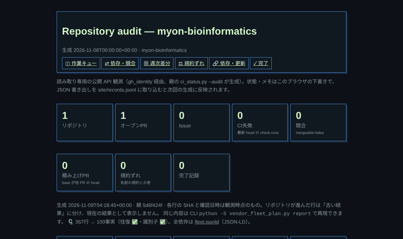

# Shared public vendor placement and CI updates

`vendor_sync.py` is a single-file, stdlib-only tool. Consumers keep an explicit
`vendor-lock/1` allowlist; there is no automatic directory discovery or dependency
resolver. Include LICENSE files alongside code. A commit is always a full SHA.
`ref` is used only by `update`/`promote`, never by locked
`materialize`/`check`/`enroll`.

Each file has `repository` (owner/repo), `ref`, `commit`, `source`, `destination`,
`blob_sha` (Git blob SHA-1), and `sha256`. Paths are relative POSIX paths. One
repository/ref is resolved once per update, so related files share the same
candidate commit. Unrelated upstream commits with unchanged selected bytes do
not churn existing pins. Group coupled contract/generator files under the same
repository/ref. Include every imported upstream sibling explicitly.

An optional `bundle` object (`minpy-bundle/1`) may be added to a file entry
without changing existing entries. It records that `source` is a single-file
bundle produced by `tools/minpy.py`: `tool`, `tool_version`, `entry`,
`search_paths`, `allow`, and `allow_cycles`. `vendor_sync.py check` still
verifies the locked bytes. `python tools/minpy.py check` regenerates the
bundle from the entry at the locked commit and compares it. See `docs/minpy.md`.

```json
{
  "schema": "vendor-lock/1",
  "files": [
    {
      "repository": "myon-bioinformatics/xprobe",
      "ref": "main",
      "commit": "326acd667e13b21bf53ccc1590af960edf8cbf6c",
      "source": "scripts/xprobe_pytest.py",
      "destination": "vendor/xprobe_pytest.py",
      "blob_sha": "70fac53151e97f5f28d23f9961d3837b7a885ea8",
      "sha256": "c0ea71f9d971bf47a9f5f1794ef8a7f641dd17694ea8e7f29795d326c5229285"
    }
  ]
}
```

This minimal schema example is not a complete consumer manifest: add the upstream
LICENSE with its independently verified hashes before adoption.

## Recreating the locked files in CI

`python -S vendor_sync.py recreate --manifest vendor.lock.json` (or `recreate(manifest, root)` from
Python) is the CI step that proves every checked-in copy can be fetched again from GitHub. It checks
the checkout copies, materializes the lock into an empty staging directory under the root (nothing in
the checkout can satisfy it), checks the staged bytes, moves them over the checkout copies one file at
a time, and checks again. A failed download or digest leaves the checked-in files in place, unlike
the inline "unlink every destination, then materialize" step it replaces. Placement is atomic per
file, not a transaction across the batch. It prints `{"schema", "mode": "recreate", "changed_paths",
"recreated"}`; `changed_paths` stays empty because the recreated bytes are the locked bytes.

Recreation must run in an isolated checkout. It rechecks the original manifest and checkout
bytes after downloads and each destination immediately before replacement, rejecting edits it
observes. This is not locking or compare-and-swap: writes racing the final verification and
replacement are unsupported. A failure during placement may leave earlier files replaced, and a
failure of the final check does not roll them back. Staging is removed in either case. Inspect the
checkout and preserve any concurrent edits; after resolving the cause and verifying the intended
lock state, rerun `recreate`. Do not delete the checkout copies as a recovery step.

## Central consumer topology

`vendor-consumers.json` is the parent-owned machine-readable registry of
cross-repository vendor placement intent. It answers **which repository consumes
which upstream source at which destination**. It deliberately does not repeat
commit, Git blob, or SHA-256 identity: the consumer's `vendor-lock/1` remains the
authority for the exact bytes actually adopted.

Source/consumer is a relationship per artifact, not a permanent repository
classification. A repository can own one shared artifact and consume another.
A repository must not enroll its own canonical artifact merely to make layouts
uniform. For example, `xprobe` owns `xprobe.py`; downstream repositories may
enroll it, but xprobe does not create a redundant self-consumer entry for
`xprobe.py`.

The registry uses `vendor-consumers/1`:

- `repository`: the consumer repository.
- `state: locked`: the relationship is represented by the listed `lock` path
  and its topology should match the registry.
- `state: legacy`: a known checked-in vendor relationship predates
  `vendor-lock/1`; `lock` is null and a machine-readable `reason` plus the
  existing `legacy_provenance` paths are recorded until migration.
- `entries`: `repository`, `source`, and `destination`, plus an optional
  `bundle` object when the source is a minpy bundle (same `minpy-bundle/1`
  shape as the lock; no commit or digest). Exact commit/ref/blob/SHA-256
  values stay in each consumer lock. A bundle metadata mismatch is
  `bundle_mismatch` and fails comparison. `html-import-vendor/1` sources may
  carry the same optional `bundle` object; sources without it are unchanged.
- Duplicate consumers or destinations, unsafe paths, and self-vendor entries are
  rejected.

The current registry includes the parent itself plus every repository found with
a `vendor-lock/1` manifest in the cross-repository audit. It also records
`search_seq_including_spaces` as a legacy xprobe consumer so the absence of a
lock is explicit rather than silently omitted.

Validate the central topology, or compare one checked-out consumer lock without
network access:

```sh
python -S vendor_consumers.py validate
python -S vendor_consumers.py compare \
  --consumer myon-bioinformatics/yourself \
  --lock path/to/yourself/vendor.lock.json
```

The CLI exits 0 for a match (or valid registry), 1 for topology drift, and 2
for input/schema/I/O errors. Drift still emits the full comparison JSON.

A comparison checks only repository/source/destination topology. It never
promotes a recommendation or treats the parent registry as evidence of the exact
bytes in a consumer checkout.

Keep the three ownership layers distinct:

1. `vendor-consumers.json` — intended consumer/source/destination topology.
2. `vendor-catalog.json` — reviewed recommended upstream baselines and
   enrollment policy.
3. Consumer `vendor.lock.json` — exact adopted commit/blob/SHA-256 identity.

Changing one layer does not silently rewrite either of the others. Consumer
migration and promotion remain explicit reviewed operations.

## Commands

```sh
python vendor_sync.py --help
python vendor_sync.py check --root . --manifest vendor.lock.json
python vendor_sync.py enroll --root . --manifest vendor.lock.json
python vendor_sync.py materialize --root . --manifest vendor.lock.json
python vendor_sync.py update --root . --manifest vendor.lock.json
python vendor_sync.py promote --root . --manifest vendor.lock.json
python vendor_sync.py evidence --root . --manifest vendor.lock.json --runtime-evidence vendor-promotion.json
```

### Node launcher for vendored Python CLIs (`py_launch.cjs`)

Parent-owned `py_launch.cjs` is a single CommonJS module (Node >= 26, `node:`
builtins only) that spawns a stdlib Python script with argv passthrough, inherited
stdio, and exit-code forwarding (exit code 2 on spawn failure, missing
interpreter, signal, or a Node older than 26). A signal prints its name on
stderr. Set `jsonErrors: true` or `PY_LAUNCH_ERROR_FORMAT=json` to emit one
stderr object `{ok:false, code, message, hint, exit_code}` for those launcher
failures. The switch does not read argv, so the child tool keeps its own
`--json`. Library callers use `run(scriptPath, args, { python,
input, timeout, maxBuffer, maxInputBytes, responseMaxBytes, env, noSite, isolated, envVar })`
with `spawnSync`, surfacing stderr on failure. `maxBuffer` and `responseMaxBytes`
are mutually exclusive; `env` merges over `process.env` without injecting
`PYTHONUTF8` / `PYTHONIOENCODING`. Requires Node 26+. Interpreter resolution
order: explicit `python`, `process.env[envVar]`
(for example Ironmate's `IRONMATE_PYTHON`), `PYTHON`, `python3`, `python`, and
on Windows `py -3`. Python older than 3.9 is rejected with a clear message (exit
2). Explicit `python` or a set `envVar` rejects Windows `.cmd`/`.bat` paths (exit 2).
Non-strict `PYTHON` pointing at a batch shim is skipped with a warning so later
candidates (`python3`, `python`, `py -3`) can run. `-S` is optional per tool via
`noSite: true`
(default off). `-I` is optional via `isolated: true` (default off). CPython
treats `-I` as `-E` plus `-s` plus `-P`: every `PYTHON*` environment variable is
ignored (including `PYTHONPATH` set through `env`), user site is disabled, and
the script directory is not placed on `sys.path`, so sibling-module imports fail
unless the script inserts its own directory (for example
`sys.path.insert(0, os.path.dirname(__file__))`, as Ironmate `flow_workspace`
did when invoking `python -I -S` directly).

Add the `vendor-catalog.json` recommendation only after the launcher is on
default branch (merge commit pin), then enroll with `vendor_sync.py` like any
other catalog source (`destination`: `vendor/py_launch.cjs`, plus `blob_sha`
and `sha256` from `inspect_source` or `vendor_catalog.py verify`). Thin
consumer wrapper (three lines):

```js
"use strict";
const { main } = require("./vendor/py_launch.cjs");
if (require.main === module) main(__dirname + "/your_tool.py", { envVar: "MY_TOOL_PYTHON", noSite: true });
```

Optional `package.json` `"bin"` can point at that wrapper for `npx
github:owner/repo#commit` style invocation; the vendored launcher stays shared.

Without a wrapper, call the vendored launcher directly:

```sh
node vendor/py_launch.cjs [--env-var MY_TOOL_PYTHON] [--site] [--] your_tool.py ARGS...
```

`--env-var NAME` (or `--env-var=NAME`) lets `NAME` choose the Python
interpreter. By default Python runs with `-S` (`noSite: true`): `site` is not
loaded, so the script must not depend on site-packages. `--site` drops `-S`
for tools that need site-packages (for example Playwright). Options go before
`your_tool.py`; everything after it is passed to the script unchanged. A lone `--`
ends the options, so the next argument is the script even if it starts with `-`.
If an option is repeated, the last one wins (`--site` twice is the same as once).

#### Calling a function or class by name (`call`, `--call`)

`call(scriptPath, target, args, opts)` imports `SCRIPT.py` from its path (its
`__name__` is the file stem, so the `if __name__ == "__main__":` block never
runs), resolves `target` as a dotted name, calls it, and returns the JSON-decoded
result. `args` is a positional array or `{ args, kwargs, init }`; `init` holds
constructor arguments when `target` is `Klass.method`. A bare class target
constructs the object and returns its fields. Return values are serialized as
JSON: dataclasses and plain objects become their fields, `set` / `tuple` become
lists, anything else (for example `Path`) becomes `str`. During the call `print`
goes to stderr so stdout stays one JSON document; `sys.argv` is `[SCRIPT.py]`, so
an argparse-style `main()` sees no stray arguments. The script directory is put
first on `sys.path` even under `isolated`, so sibling imports work. A Python
exception is a failed run (exit 1, traceback in `err.stderr`); `callRaw` returns
the `spawnSync` result instead of parsing it. Options are the same as `run()`
except `input`, which the request already uses.

```js
const { call } = require("./vendor/py_launch.cjs");
const info = call(__dirname + "/yourself.py", "collect", { kwargs: { include_host: true } });
const n = call(__dirname + "/tool.py", "Counter.add", { init: [100], args: [5] });
```

```sh
node vendor/py_launch.cjs --call collect yourself.py            # {"schema_version": 1, ...}
node vendor/py_launch.cjs --call add tool.py 2 3                # each ARG is JSON if it parses, else a string
node vendor/py_launch.cjs --call main tool.py '["--format","json"]'
```

### Python launcher for vendored Node scripts (`njs_launch.py`)

Parent-owned `njs_launch.py` (named `node_launch.py` until 2026-11-13; the name now mirrors `py_launch.cjs`: the runtime it starts, then its own extension) is a single stdlib module (Python 3.9+) that spawns
Node with argv passthrough, optional stdin/stdout capture as bytes, and inherited
stdio in `main()`. Library callers use `run(target, *args, node=..., input=...,
timeout=..., max_input_bytes=..., response_max_bytes=..., env=..., env_var=...)`
or `run_argv(argv, ...)` for `-e` one-liners. `env` merges over `os.environ`
case-insensitively on Windows. Node 26+ is required (`resolve_node` probes
`node --version`). Resolution order: explicit `node`, `os.environ[env_var]`
(for example `CLI_ARGS_NODE` or `NODE`), then `shutil.which("node")`. Explicit
`node` or a set `env_var` value does not fall back. Windows `.cmd`/`.bat` shims
are rejected (no `shell=True`). Size caps raise `EINPUTTOOLARGE`,
`ERESPONSETOOLARGE`, or `ELAUNCHFAILURE` like `py_launch.cjs`.

Add the `vendor-catalog.json` recommendation only after the launcher is on
default branch (merge commit pin), then enroll with `vendor_sync.py` like any
other catalog source (`destination`: `vendor/njs_launch.py`; locks made before the rename keep `vendor/node_launch.py` at their pinned commit; plus `blob_sha`
and `sha256` from `inspect_source` or `vendor_catalog.py verify`). Thin
consumer wrapper:

```python
import njs_launch
if __name__ == "__main__":
    njs_launch.main(__file__.replace("_wrapper.py", ".mjs"), {"env_var": "MYON_NODE"})
```

`--help` exits before filesystem/network activity. `check` is offline and fails
on missing or mismatching files. `materialize` reuses verified local copies or
fetches raw bytes at the locked commit, verifies both hashes, then places them.
It never resolves `ref`. `update` resolves the explicit upstream refs and checks
GitHub file metadata against downloaded Git blob hashes, records SHA-256, then
places the candidate files and updates the lock. It first checks every current
file against the old lock, rejecting missing files or local edits before any
network call. Use `materialize` explicitly if restoring missing/incorrect locked
copies is intended; updates never silently repair local edits. `materialize`,
`update` and `enroll` validate the whole download batch before writing;
placements are atomic per file, not a
filesystem transaction. `promote` is the explicit reviewed-baseline operation:
it uses the same update resolver, verifies the promoted baseline offline, and
prints a deterministic `vendor-promotion/1` receipt containing old/new commit,
Git blob SHA and SHA-256 identities. Promotion backs up the locked manifest and
all locked destination bytes and rolls them back if update or verification
fails. It never commits, pushes, opens a PR, or writes to GitHub. Run updates in a disposable clean checkout. Network,
missing-file and verification failures are nonzero (CLI exit 2).

### Enrolling new destinations

Use `enroll` after adding reviewed exact commit/blob/SHA-256 entries, including
the source's LICENSE, to a consumer lock. The complete lock and destination
paths are validated first. Every existing destination must already match its
locked bytes; a mismatch fails before any network call or placement. Only the
destinations missing at this initial check are selected for download, at their
locked commits. Enrollment never resolves `ref`, rewrites the lock, repairs a
local edit, or writes to GitHub. Repeated enrollment is a no-op.

All missing downloads and both digests are verified before placement, then
existing destinations are checked again. A file created during downloads is
left untouched if exact; a mismatch aborts before any new placement. Each new
file is staged and installed using a hard link, so a destination created even
at the final installation boundary cannot be overwritten. An exact file that
appears at that boundary is a no-op; a mismatch is an error. The destination
filesystem must support hard links; there is no overwrite fallback. Enrollment
finishes with ordinary offline `check`, and `changed_paths` lists only the
destinations this invocation created.

This is a verified download batch, not a filesystem transaction. An I/O error
during placement, or a conflicting file created after the final batch check,
can leave earlier verified new files installed. After resolving the error,
rerun `enroll`: completed exact files are retained and only missing files are
selected. Use an isolated checkout; concurrent changes to directories or the
manifest are unsupported. Observed destination and parent symlinks are rejected
before placement.

For a newly enrolled consumer, run `enroll` and then `check` before its usual
locked/candidate test sequence. Pin a canonical tool revision that supports
`enroll`; an initial `check` alone must still reject missing destinations.

For locked `materialize` and `enroll`, raw HTTP 403/429 also uses the anonymous public Git
fallback at the exact locked commit. Snapshots are cached by repository and
commit, so mixed historical pins remain independent. Returned commit/blob and
downloaded SHA-256 must match the existing lock; the lock is never rewritten.
Enrollment's fallback reads only sources selected as initially missing; already
verified local files are excluded from the snapshot request.
Other HTTP errors remain failures, and the whole batch is verified before writes.

Existing file permissions are retained; new files default to 0644. Manifest
collisions and duplicate destinations are checked case-insensitively.
The updater never imports candidate code or installs runtime dependencies. Upstream selection is not a compatibility guarantee: consumer CI evaluates the candidate in its disposable checkout. Files over 8 MiB are rejected; the scope is
small public shared Python modules and their licenses, not models or packages.
Only **public upstream repositories** are supported. Raw downloads and metadata
calls are anonymous; no environment token is read or sent. Anonymous API rate
limits apply to updates. HTTP 403/429 switches to anonymous public Git fetch
in a temporary bare object store, reading the same allowlisted regular files
and verifying their Git blob identities. Git must be available for this path
(as it is on Actions runners). User credential helpers/config are disabled.
If metadata already resolved a full SHA, the Git fetch uses and verifies that
exact SHA. No consumer Git changes or remote writes occur. Other download
errors, failed Git reads and digest mismatches remain nonzero; old bytes are
never substituted to make CI pass. Slash-containing refs are encoded as a `sha` query parameter on the
lightweight commit-list endpoint (`per_page=1`), which omits commit patches;
an empty result is an explicit error.

## CI-only updates

Consumer CI first uses `check` and `materialize` at the recorded full commits,
then runs `update`, `check` and the existing tests automatically. No human
manual-dispatch step is required. An ALM agent can use the same CLI sequence in
its checkout. A dispatch input `vendor-mode` may select `locked` for an explicit
baseline run; ordinary push/PR events and default dispatches use `update`.
Resolve each allowlisted upstream ref once per command and record the resulting
full SHA/blob/SHA-256 before testing. The executable updater itself stays pinned.

Updates modify source/license/lock files only in the disposable CI checkout.
They do not persist to main, create branches, push, open PRs or auto-merge. The
former reusable PR-proposal workflow and dedicated token/enable-flag contract
are removed. No additional token or repository secret is required. CI checkout
permissions remain read-only, and vendor tool checkouts disable persisted Git
credentials. Shared-tool pin changes remain explicit infrastructure changes.

## Current-main audit, 2026-10-03

Read all eleven supplied repositories' main trees and open PRs. No vendor-update
automation PR was present. Provenance uses several existing shapes; migrate each
consumer's provenance tests/readers deliberately to the lock, rather than
guessing field aliases or overwriting legacy provenance behind their back.

| Repository | Existing copies / current overlap | Rollout order |
| --- | --- | --- |
| yourself | vendor/xprobe_pytest + LICENSE; JUnit #7 merged; thin-main #5 separate | First small placement/CI update pilot |
| nvd_nist_known_vulns | Same adapter provenance shape as yourself | Reuse tested pilot |
| convert_img_fmt_to_webp-CUI- | Adapter under scripts; different provenance fields | Adapt paths and provenance checks |
| ascii_artist | Five shared metadata/resolver/inspector modules; JUnit #27 merged | Group related source files |
| markdown | Same five modules; JUnit #88 merged; identity #86 open | Avoid overlap with #86 |
| mcp-toolcall-lab | Seven vendor modules; JUnit #95 open | Preserve test-only boundary; coordinate #95 |
| Ironmate | vendor modules plus root provenance helper; identity #57 open | Avoid overlap with #57 |
| browser-test-kit | browser-test and evidence scripts; gh_ops removed in favor of parent | Coordinate consumer lock updates with parent registry |
| web-ui | tool/vendor grouped metadata provenance + LICENSE | Preserve grouped-source contract |
| xprobe | Parent LICENSE snapshot only (`vendor/myon-bioinformatics-LICENSE`) | Upstream source of `xprobe.py`; locked consumer of the parent LICENSE only, no self-consumer entry |
| myon-bioinformatics | Shared inspector/workflow source, no vendor directory | Own public placement/update tool |

The older JUnit report's missing `artifact-pattern` concern is already addressed
in yourself's merged #7 (`test-report-*`). A commit looking old does not by itself
prove byte drift: xprobe #7 changed tests/docs/CI, not the adapter source. The
child `-c os.devnull`/rootdir concern and CLI/import/README issues remain separate
checks; this automation PR does not claim they are all resolved.

For each consumer: adopt a complete lock preserving current bytes first, migrate
provenance checks, verify offline local tests, then wire CI placement and automatic updates
to a reviewed shared-tool commit. Verify locked and candidate test runs. Current deployment/Pages and
runtime dependency policies are unchanged.


The offline `evidence` mode derives `vendor-evidence/1` locked/candidate paths from the validated lock and manifest. Generated runtime receipts are passed with repeatable `--runtime-evidence` and remain separate; path collisions fail. This operation does not access the network or require receipt files to exist.


## Canonical artifact staging (#44)

`vendor_stage.py` lives beside `vendor_sync.py` in the parent repository. Fetch
both via a full-commit pinned checkout and invoke the shared script directly:

```sh
python -S .vendor-sync-tools/vendor_stage.py --root . \
  --manifest vendor.lock.json --kind candidate --output build/vendor-evidence \
  --promotion-receipt vendor-promotion.json \
  --legacy-evidence tool/vendor/provenance.json
```

Upload the generated directory. The lock alone defines locked/candidate membership;
adding an enrolled source or license requires no staging path-list edit. `kind`
labels the selected snapshot and does not certify an update or test outcome.
`--runtime-evidence` names required supplemental files; `--promotion-receipt`
includes an optional file only when present in a candidate run (omitted for locked
runs). A failed or incomplete receipt remains diagnostic bytes, not a successful
promotion claim. `--legacy-evidence` is an explicit consumer-specific projection
path, never a second list of canonical vendor members. The stager copies existing
legacy output; it does not infer, regenerate, or certify a consumer's legacy format.

The generated `vendor-evidence.json` retains `vendor-evidence/1` locked, candidate,
and runtime arrays, and adds `kind`, `legacy`, and a `sha256` map for every copied
file. Legacy files are classified separately, and runtime/legacy paths cannot
collide with lock members or the generated manifest. Receipt and legacy files
remain outside the checked-in lock. Required inputs, regular-file paths, byte
identities, case-insensitive collisions, path ancestry, and output paths are checked
before creating the directory. Existing output, symlink components (including
in-root and dangling links), traversal, metadata-name collisions, and source/output
overlap are rejected. Source bytes are read once, verified against the lock, and
then copied; a copy failure removes the partially staged directory. The command is
offline, stdlib-only, and never imports vendor modules. Use an isolated checkout;
concurrent directory/manifest changes are unsupported, as in `vendor_sync`.

## Recommended baseline catalog (#46, first phase)

`vendor-catalog.json` is a separate, explicit recommendation, not a consumer
lock or an alias for development main. `vendor_catalog.py` (stdlib-only, beside
canonical `vendor_sync.py` in this repository) provides read-only operations:

```sh
python vendor_catalog.py validate
python vendor_catalog.py compare --lock vendor.lock.json --consumer owner/consumer
python vendor_catalog.py verify
```

Consumer-held catalog snapshots (for example copied into a child repository) may
call `validate --allow-legacy-implicit-source` until **2027-04-01** to accept
omitted `source` fields using the retired `<repository>.py` default; each
omission emits a `DeprecationWarning`. After that date the flag is ignored and
omitted `source` is always an error. The parent `vendor-catalog.json` must
always declare `source` explicitly.

`validate` and `compare` are offline. `verify` reads public Git objects into a
throwaway bare repository through `vendor_sync.inspect_source`; it requires Git.
It verifies the full resolved commit, regular-file tree mode and Git blob against
retrieved bytes, and computes SHA-256. It never imports the source. Output is JSON;
invalid input or retrieval errors exit 2. No command places consumer files,
rewrites locks, promotes, commits, pushes, or creates PRs. Verification is identity
evidence, not candidate compatibility CI or an import-safety assessment.

### Contract: vendor-catalog/1

The top-level fields are exactly `schema` and nonempty `tools`. Each tool has
`repository` (`owner/repository`), `commit` (40 lowercase hex characters),
`source` (relative POSIX path to the recommended file), and nonempty audit
`reason`. Omitted `source` is rejected; there is no repository-name default.
Each repository name must normalize to a valid Python identifier by lowercasing
and replacing `-` and `.` with `_`, rejecting Python keywords; two different
repositories (even under different owners) whose names normalize to the same
module identity are rejected so independent `vendor/<module>.py` paths cannot
collide. Repository strings that differ only by case refer to the same consumer
and do not trigger a normalization collision. A stdlib min artifact is a second
tool on the same repository, with `source` `<stem>_min.py`, not a second
repository (normalized repository module names therefore do not collide).
Optional `consumers` records per-consumer policy exceptions or explicit enroll
decisions. Unknown fields and duplicate repository/source pairs are rejected.
The recommendation unit is an independent source artifact,
identified by repository/source, rather than an entire repository release.
Different sources from the same repository are intentionally allowed for
standalone helpers; each carries its own explicit recommended commit. This does
not express coupled-file dependencies, a shared-commit constraint, compatibility
between sources, or atomic multi-file promotion. Coupled artifacts need a future
explicit grouping contract; multiple entries alone must not imply such guarantees.
A future incompatible contract needs a new schema version.

```json
{
  "schema": "vendor-catalog/1",
  "tools": [{
    "repository": "owner/shared_helpers",
    "commit": "1111111111111111111111111111111111111111",
    "source": "helpers/standalone.py",
    "reason": "Illustrative override, not a live recommendation",
    "consumers": {
      "owner/unused_consumer": {
        "enrollment": "enrolled", "reason": "safe_unused_copy"
      },
      "owner/incompatible_consumer": {
        "enrollment": "skipped", "reason": "requires_external_package"
      }
    }
  }]
}
```

Absent consumer decisions default to `enrolled` with
`reason: default_single_file_policy`. Both explicit decision types require a
machine-readable lowercase snake_case reason. Enrollment here is **policy**,
not proof of placement, runtime use, safety, or passing tests. Catalog maintainers
must assess the Issue #46 inert single-file/stdlib threshold before publishing a
recommendation; unused alone is not a skip reason. Skip neither removes existing
locked entries nor hides their comparison. LICENSE remains separately and
explicitly locked under the existing vendor rules; this catalog is not a complete
placement manifest. Source overrides do not infer source renames in old locks.
Changing a source path, even at the same commit, intentionally reports `missing`
when no lock entry matches that new repository/source. Treat it as a new artifact:
explicitly review its source identity, LICENSE and destination before enrollment.
The old lock entry remains independent; this read-only comparison neither maps
the old source to the new one nor removes or rewrites it.

Comparison matches repository (case-insensitive) and exact source path, retaining
all matching lock entries including their destinations, commit/blob/SHA-256 and
ref. `missing`, `at_recommended`, and `different` describe commit pin equality
only, without assuming ancestry or claiming byte parity. Unrelated entries such
as LICENSE are outside that tool's comparison. Even identical source bytes at
different commits report `different`; malformed locks fail existing
`vendor_sync.validate` unchanged. Consumer locks remain authoritative for all
existing materialize/check/enroll operations.

Initial recommendations deliberately retain the parent's existing gh_identity
pin and the previously adopted xprobe JUnit bridge baseline, not today's moving
main. A later recommendation is a reviewed catalog commit. Development heads,
consumer locks, and catalog commits advance independently. Candidate CI,
fleet compatibility receipts, automatic PR creation and coordinated promotion
remain future phases; the candidate CI connection below does not change existing
development-head CI update behavior.

## Recommended candidate CI (#46, second phase)

`vendor_candidate.py` reuses the catalog, consumer registry and canonical
`vendor_sync` Git snapshot/digest/check operations. The first connected consumer
is this parent repository; the proving artifact is `gh_identity.py` and its
explicitly locked LICENSE. `.github/workflows/vendor-candidate.yml` automatically
runs on relevant PRs/main pushes, and supports manual dispatch, on development/test Python 3.11
and 3.14 with read-only permissions and no persisted checkout credentials.

```sh
python -S vendor_candidate.py --root . \
  --consumer myon-bioinformatics/myon-bioinformatics \
  --repository myon-bioinformatics/gh_identity --source gh_identity.py \
  --test tests/test_gh_ops.py --output ../candidate-results
```

The output directory must be new, outside the consumer root and without symlink
components. The registered lock topology and all locked source bytes are checked
before fetching. The catalog selects a full commit, independently of `ref` or
upstream main. Source and LICENSE are fetched together from that exact Git
snapshot; resolved commit, regular-file mode, Git blob and SHA-256 are checked
before placement. Candidate metadata uses the verified source bytes, never an
unverified catalog digest. Files and a temporary candidate lock are placed only
in a disposable copy of the consumer. Other locked artifacts retain their pins.
The original consumer lock, source files, catalog and registry are never written.

Tests are explicit trusted consumer Python paths supplied by the workflow/operator;
they are not catalog-provided commands. `tests/test_gh_ops.py` exercises the actual
parent gh_identity loader and its callers, rather than testing only upstream code.
Candidate integrity is checked again after tests. This copy isolates accidental
relative writes; it is **not a security sandbox** for malicious tests. Concurrent
input changes and coupled multi-source recommendation groups are unsupported.

`verification.json` uses `vendor-candidate-verification/1`:

- `success` / `candidate_compatible`: identity checks and selected tests passed,
  with nonempty JUnit and no skipped cases. This is compatibility evidence only
  for the named tests and Python environment, never promotion authorization.
- `mismatch`: locked/candidate identity mismatch or test failure. The original
  lock remains unchanged.
- `unverified`: retrieval/runner/input failure, explicit skip, missing enrollment,
  absent tests, missing/invalid/empty JUnit, or skipped cases. Never treated as a pass.

The receipt records the consumer/tool, selected recommended commit, original lock
SHA-256, normalized catalog/registry SHA-256, locked and candidate file identities,
selected test paths, test exit status/output, JUnit SHA-256 and `promoted: false`.
Successful CLI exit is 0; all other outcomes exit 2. Candidate JUnit is retained
when produced, including failed tests. Actions uploads diagnostic JSON/JUnit even
when verification fails, plus the offline verifier regression JUnit. The artifact's
workflow run/head provides the consumer revision identity. Output creation errors
exit before verification; otherwise input errors produce an unverified receipt.

This phase neither updates recommendations nor promotes/commits/pushes/opens PRs
from CI. Baseline recommendation remains a separate reviewed catalog change.
Fleet fan-out, consumer-specific test selection contracts, reusable compatibility
receipt validation, release-train aggregation and coordinated promote remain
follow-up work. Existing development-head CI update behavior is unchanged.

### First live candidate result

On 2026-10-11 the parent lock used gh_identity `c950ed3882f05668575b7298a67bc811e9cf925a`,
while the catalog recommended `fc2c527257b12eb99c00637bbae74f8988fd6bf4`.
Exact candidate retrieval/digests passed, but the parent tests produced 123 passed
and one failure: `test_default_open_prs_uses_bounded_canonical_search` needs
`gh_identity.search`, absent from the recommended revision. The receipt reports
`mismatch` / `tests_failed`; the candidate Actions job is intentionally nonzero
until a separate reviewed recommendation or consumer compatibility change.
Do not suppress this test, advance the catalog implicitly, or promote this candidate.

### Explicit compatible recommendation

The catalog now explicitly recommends gh_identity
`c950ed3882f05668575b7298a67bc811e9cf925a`, the already installed parent baseline
that provides the required canonical search API. This is a reviewed recommendation
change, not automatic adoption of the upstream development head. The runtime
`vendor.lock.json` and vendored source/LICENSE remain unchanged.

`docs/vendor-catalog-verification.json` and the initial coverage report are historical
snapshots of the earlier catalog, not verification receipts for this recommendation.
Current compatibility evidence comes from the candidate workflow for this commit.

Equal recommended and installed commits do not skip verification: source and LICENSE
are still fetched from the exact commit, their identities checked, and the real
consumer tests run in the disposable copy. Fetch or test failures remain non-success.

## Read-only fleet registration plan (#46)

`vendor_fleet_plan.py` combines the reviewed recommendation catalog and
parent-owned consumer topology into a **read-only** registration worklist:

```sh
python -S vendor_fleet_plan.py --consumer myon-bioinformatics/Ironmate
python -S vendor_fleet_plan.py
```

It emits `vendor-fleet-plan/1` JSON with one row per selected consumer and
catalog tool: `registered`, `needs_registration`, `skipped`, or
`legacy_consumer_review`. A missing registration has a null destination:
the planner does not invent a placement path or copy any bytes. Skips include
their explicit policy reason, and an existing enrolled relationship is
reported even if a newer catalog default skips it. An optional repeatable
`--consumer` limits the report to known registered consumers.

This is **not** a replacement for `vendor_consumers.py compare` (which
compares an actual lock), `vendor_catalog.py compare` (which compares
recommended commit pins) or `vendor_sync.py check` (which verifies bytes).
`candidate_compatibility: unverified` is always explicit: a registration
plan never means tested, safe to promote, or fully installed. Only the
existing registered fleet is covered here; repository discovery is the
`targets` command below. The registration plan makes no network calls, imports
no candidate source, and performs no filesystem writes.

Parent CI automatically emits the read-only JSON report as the
`vendor-fleet-plan` artifact when the catalog/registry/planner changes
and also supports manual dispatch. Since existing registrations may
intentionally be incomplete, this report is **advisory** and does not
silently fail the workflow for every candidate. `--fail-on-missing`
provides an explicit strict exit-1 check for a selected consumer cohort.
Canonical source artifacts owned by the consumer itself are excluded,
because self-vendoring is forbidden by the registry contract. For a new
registration request, add a reviewed catalog entry or explicit consumer
relationship in the parent; this alone does **not** mutate the child's
lock or place files. An eventual parent-led candidate PR still requires
source/LICENSE verification and the consumer's CI gates.

### Fleet entry point: discover, graph, plan, test, report

The same file is the one entry point for cross-repository work, the way
`python -m unittest discover` is for tests. Without a command it prints the
registration plan above, unchanged. With a command it discovers its targets from
records that already exist and aggregates one result:

```sh
python -S vendor_fleet_plan.py targets --checkouts ..          # 🎯 target / 🚫 excluded / ❔ insufficient
python -S vendor_fleet_plan.py graph   --checkouts .. --check  # 🔗 edges, 🔁 mutual repositories, ⭕ execution cycles
python -S vendor_fleet_plan.py impact  py_launch.cjs --checkouts ..
python -S vendor_fleet_plan.py plan    --checkouts ..          # 🌊 dry-run (default)
python -S vendor_fleet_plan.py plan    --changed py_launch.cjs --checkouts .. --apply
python -S vendor_fleet_plan.py test    --checkouts .. --repos cli_args,xprobe -p 'test_*.py' -k runtime --jobs 4
python -S vendor_fleet_plan.py report  --fetch --previous old.json --format markdown --out new.json
python -S vendor_fleet_plan.py graph   --checkouts .. --format jsonld > fleet.jsonld
python -S vendor_fleet_plan.py query   deps Ironmate            # 🔎 from the published fleet.jsonld, no checkouts
python -S vendor_fleet_plan.py query   who web-ui               # name, previous name or repository_id → identity
python -S vendor_fleet_plan.py query   facts xprobe --severity updated
python -S vendor_fleet_plan.py query   why 'Aoi:cycles/c001-chunichi/outputs/ledger.jsonl#P1'  # 判断の根拠
python -S vendor_fleet_plan.py query   reverify PySaiyanWeBoo:web_ui.py   # 影響先・再テスト・再検証
```

`--checkouts DIR` holds clones named like the repositories (worktree or bare
`NAME.git`); the parent is read from its working tree, so a local edit of the
registry or a shared file is what gets planned. `--fetch` clones a missing public
repository once, anonymously, bare, blob-less and depth 1, and fetches the blobs
a run needs in one batch per repository. Every tree and blob is read once per run
(`♻️` line). Without `--fetch` nothing touches the network.

| Need | Already there (reused) | Added here |
| --- | --- | --- |
| Targets | `vendor-consumers.json`, `child-heads.json` (parent and Aoi), `vendor-catalog.json`, each lock, `vendor_consumers.compare` | One classification with reasons: legacy/archived/source-only are 🚫, a consumer without a head, a head without topology, registry ≠ lock, a lock outside every hub are ❔ |
| Graph | Lock rows, `vendor_sync.collect_workflow_pins`, hubs' `subtree_prefix`, `shared-tools.lock.json` | File-level edges (`vendor`, `launcher`, `license`, `workflow-pin`, `heads`, `subtree`, `catalog`, `shared-tools`), `graphlib.TopologicalSorter` order; 🔁 repository-level mutual references are information, ⭕ file-level cycles are errors |
| Impact and plan | `vendor_sync.py update` (no-churn), `refresh-child-heads`, `pilot/vendor_dispatch.py --record`, `gh_ops.py subtree-push`, `tools/parent_pin_check.py` | Direct/indirect consumers; ordered waves vendor → regenerate → verify → record; identical bytes are ⏭️ even when the source commit moved; `vendor_sync.py update --only DEST --to-ref SHA` updates only the planned entries |
| Tests | `unittest.TestLoader`, each repository's `uv.lock`, the [2026-11-03 recipes](unittest-discovery.md) | Per repository: offline `vendor_sync.py check` first, then unittest groups (`loadTestsFromNames`, `testNamePatterns`) or one pytest group in `uv run --locked`; disposable detached worktree per job, cleaned environment, graphlib order, parallel `--jobs`; a failed check blocks its tests |
| Results | `ci_status.py --audit` snapshot, Pages workbench and `report.html` | `vendor-fleet-report/1`: ✅ success / ❌ failure / 🔄 updated / ⏭️ skipped / ⛔ blocked / ❔ unavailable, SHA and time per row, carried rows only while the SHA is unchanged (otherwise 🕰️ stale), diff to the previous report, remaining actions as numbered facts |
| Knowledge graph | `child-heads.json` `repository_id`, lock rows as provenance | One codebook (classes, relations, domain/range, PROV parents), identity and shape checks, JSON-LD export, compressed facts |

How each piece decides:

- **Locks.** `vendor.lock.json` rows are vendor edges from `repository:source` to
  `consumer:destination`; a lock under a hub's subtree prefix is relative to that
  prefix. A `shared-tools.lock.json` row with `consumers` declares who uses an
  original; a row with only `path`/`source`/`sha256` is the consumer's copy record,
  matched to the original by path. `html-import-vendor/1` rows are sha256-only.
  The same dependency recorded in two locks counts once; different pins are a finding.
- **Pins.** A reusable workflow `uses: …@SHA` depends on that parent workflow file.
  A pinned whole-repository checkout depends on the parent files the workflow then
  uses under its `path:`; one that nothing uses is reported, not modelled. The
  parent checking out its own older commit is a historical fixture, and the parent
  recording its own head in `child-heads.json` is not a dependency.
- **Plan rows.** Content is compared by Git blob (sha256 for sha256-only records).
  A source path removed at main is ❌ (re-point or drop); a source that is excluded
  is ⏭️ with the reason; an unreadable in-scope source is ❔. An update that needs an
  intermediate repository (parent → Aoi → NagoyAction) waits for that repository's
  verify step; a subtree child receives the copy with the hub's subtree push.
  Only `vendor` and `verify` steps are 🤖 automatic; records, pins, subtree pushes
  and anything after a merge are 👤 and hold their dependents under `--apply`.
- **Tests.** Test files are `test*.py` (or `-p`) under a `tests`/`test` directory.
  A file with a `TestCase` and no pytest import runs in one `unittest-worker`
  subprocess per directory (`python -I -S`, or `uv run --locked python -I` when it
  imports a third-party package); everything else runs as one pytest group in
  `uv run --locked`. `--related TEXT` keeps files that mention TEXT (used by plan
  verify steps). Zero selected tests is ⏭️, never ✅. Exit 0 needs no ❌/⛔.

Real-data check (2026-11-09, 24 public repositories): local clones and fresh
anonymous `--fetch` clones gave the same result: 22 🎯, 15 🚫 (archived catalog
sources, one legacy consumer), 2 ❔ (BrowserTestKit and PySaiyanWeBoo removed
vendored gh_identity/gh_ops copies that the registry still lists; at `--at heads`
both are 🎯, so refreshing their heads needs a registry update first), 392
edges, 0 cycles, 6 code-level mutual pairs, 71 steps in 3 waves; 14 ❌ rows are
Ironmate/github.io copies of PySaiyanWeBoo flow/JS files removed at main. The
graph also found the Aoi `shared-tools.lock.json` gaps (QueRyu's `numpy_min.py`,
Ironmate's `fetch_module.py`) and an unused pinned parent checkout in
BrowserTestKit `runtime-compatibility.yml`. `test --runner unittest --jobs 8`
ran 1888 tests in 23 repositories in 2 minutes (49 ✅, 2 groups re-run in their
`uv.lock` environment because a local module imports polars; NagoyAction ❔: it
needs packages but has no `uv.lock`, its tests run inside Aoi). pytest groups
in `uv run --locked` passed for gh_identity (1176), xprobe (673) and yourself
(264); cli_args, TalkCompress and ascii_artist failed only on network access or a
module their CI downloads separately (`xprobe`), which the first error line shows.

#### Evidence: tests, generators, receipts, ledgers, PRs

`impact` and `report` also walk the relations the repositories' own records support — `tested_by`, `produced_by`,
`derived_from`, `observed_in`, `verified_by`, `supports` / `contradicts`, PR `depends_on` — and answer
変更の影響先 / 判断の根拠 / 再テストが必要な対象 / 再検証が必要な記録 / 再テスト対応が未登録 with the record each answer
rests on. Plan rows split `content` (match/different), `commit` (same/different) and `compatibility`
(not_assessed until tests run), so a moved commit is never read as outdated. `query why|reverify` answers the
same from `fleet.jsonld`. Spec, adapters and real-data examples: [fleet-records.md](fleet-records.md).

#### Ontology and knowledge graph

The graph has one codebook, `CLASSES` and `RELATIONS` in `vendor_fleet_plan.py`,
that every part reads: planning (`UPDATE_KINDS` are the relations whose phase is
`vendor`), mutual references (`code` vs `record` group), icons, shape checks and
the export. Each relation reads "target *relation* source".

| Code | Relation | Domain → range | Group | Plan phase | PROV |
| --- | --- | --- | --- | --- | --- |
| `vd` 📥 | vendor | File → File | code | vendor | `prov:wasDerivedFrom` |
| `ln` 🚀 | launcher | File → File | code | vendor | `prov:wasDerivedFrom` |
| `lc` ⚖️ | license | File → File | code | vendor | `prov:wasDerivedFrom` |
| `wp` 📌 | workflow-pin | File / Workflow / Repository → Workflow | code | regenerate | `prov:used` |
| `st` 🌿 | subtree | Directory → Repository | code | regenerate | `prov:wasDerivedFrom` |
| `sh` 🧰 | shared-tools | File → Repository | code | — | — |
| `hd` 🧷 | heads | Repository → Record | record | record | `prov:used` |
| `ct` 📚 | catalog | File → Record | record | record | `prov:used` |
| `in` ↳ | implied | File … → Directory / Repository | structure | — | — |

- **Identity.** A repository is identified by the `repository_id` its hubs record
  (parent and Aoi `child-heads.json`); the name is a label. One id under two names
  (`same-repository-two-names`) and one name with two ids (`identity conflict`) are
  findings, so a rename never silently splits a node.
- **Shapes.** `check_shapes` is a small SHACL-like check of the codebook: domain and
  range per relation, exactly one origin per copy (`two-sources`), and every
  repository an edge names is known (`unknown-repository`).
- **Provenance.** Every edge keeps the record that asserts it (`assertedBy`: the
  lock, workflow or hub record), its pin and blob, and the time of observation.
- **Export.** `--format jsonld` (and `fleet.jsonld` next to the Pages `data.json`)
  is the graph as JSON-LD: the codebook is the `@context`, classes and relations
  are in the graph with `rdfs:domain`/`rdfs:range`/`rdfs:subPropertyOf`, every
  node has its class and identity, and every edge is a `Dependency` statement
  with provenance. On the 2026-11-09 fleet it expands to 4114 RDF triples (checked
  with pyld). Agents can load it instead of surveying the repositories again.
  The remaining actions are in it too, as `Fact` nodes (`FLEET-n`, key, severity,
  detail, repositories).
- **Query.** `query deps|who|facts` answers from that document alone (the
  published URL by default, `--graph FILE` for a local one): what one repository
  depends on grouped by relation (hub records about it included), which
  repository a name, a previous name or a `repository_id` is, and which remaining
  actions mention a text. `query(kind, term, graph=…)` is one function, so Node
  (`node py_launch.cjs vendor_fleet_plan.py query facts xprobe --format json`)
  and the MCP wrapper in mcp-toolcall-lab's `github_ops_server.py` (`fleet_query`)
  reach the same code. Exit 1 when nothing matches. Previous names come from `child-heads.json`
  `optional.previous_names`; `refresh-child-heads` fills it when a registry name
  changes but the `repository_id` is already recorded under the old name.

#### Compressed facts (ideas reused from TalkCompress)

Many rows say one thing ("xprobe.py 7595fe5→9d9071f" in six repositories). The
report groups them into facts with the TalkCompress rules, reimplemented in a few
lines rather than imported (TalkCompress is not a vendor source of the parent):

| TalkCompress | Here |
| --- | --- |
| Only a public, fixed codebook; no ad-hoc abbreviations | `RELATIONS`/`CLASSES` and `PATH_CODES` (`⚙️` = `.github/workflows/`) are the only codes; the JSON-LD `@context` publishes them |
| Shared ledger: send the rules once | A fact keeps the fields its rows share once; rows keep only what differs; derivable fields (row id, repository) are rebuilt |
| Round trip | `expand_facts(compress_rows(rows)) == rows`, checked in every report (`roundtrip ✅`) |
| keep-check (`shared/keep_check.py`): identifiers must survive | `kept_identifiers` checks every repository, target path and source in the rendered remaining list after expanding path codes |
| Count the whole cost, codebook included | `🗜️ 367 rows → 100 facts · 209,656 B → 110,522 B (+ codebook 1,802 B)` |

A fact is one decision: a record relation groups by the record ("child-heads.json
behind main"), a failure groups by the source repository ("PySaiyanWeBoo: 14
source paths removed"), an update groups by the source file and its new blob, so
version skew stays visible (`markdown.py →d87f394: Aoi ←9294cab, Ironmate
←3fc9edd`). Remaining actions are these facts, numbered `FLEET-n` with the fact
key as the common identifier; a number stays with its key across reports (via
`--previous`), new keys take the next number. On real data the list went from 90
lines to 24. `gh_ops.py fleet-issues fleet.json --repo OWNER/HUB` files them as
Issues, one per fact, matched by the key ([details](gh-ops.md#fleet-facts-as-issues-fleet-issues)).

CI keeps the two kinds apart. `vendor-fleet-plan.yml` (pull request / push of the
records or the planner) runs the offline graph of the parent's records with
`--check` and the synthetic-repository tests under `python -S -m unittest`; the
planner's pytest coverage stays in `python-tests.yml`. The latest-source audit is
part of the daily Pages build (`pages.yml`): `tools/build_audit_pages.py` adds the
report for the public inventory to `data.json`, shown as **🔗 依存・更新** in
`report.html` and per repository in the workbench. A failed analysis is published
as unavailable and never blocks the PR audit. Clones are anonymous; no token,
local path or private name reaches the JSON or the page.



## Compact license references

A registry entry may use one local path instead of repeating a LICENSE entry:

```json
{"repository": "owner/tool", "source": "tool.py", "destination": "vendor/tool.py", "license": "vendor/tool-LICENSE"}
```

`vendor_consumers.validate` expands `license` to the same repository's upstream
`LICENSE` and that local destination before the existing topology checks. It does
not mutate the input. An absent locked LICENSE or duplicate/unsafe destination
still fails. Put a shared license on one source entry only. A nonstandard upstream
license filename or a license-only enrollment uses the existing explicit entry.
The separately verified `vendor-lock/1` commit/blob/SHA-256 records remain intact;
this is a shorter registry representation, not a weaker license check. MIT text
and copyright notices remain unchanged. Aoi manages subtree children in its own
child registry; the account parent remains responsible for its direct consumer
baselines. Whole-subtree synchronization and optional minpy file consumption are
separate mechanisms.

### 2026-11-09 親PR統合時のmcp-toolcall-lab基準更新

#223のweb_ui登録は、旧基準1184ba449e146cb8f101aaa743449eb71a1afeb9では未採用だった。
公開・非archived・repository_id=1374450603を確認し、子mainの
31ff99fbe4c13b3feb570ae3ba1fc7cf972f8a16を明示的に再確認した。
11件すべてについて、各sourceの記録済みcommitにあるGit blob SHA・SHA-256と、
この子revisionの配置ファイルのバイト一致を読み取り検証した。
web_ui.py/対応LICENSEの2件追加に加え、markdown.py/node_launch.pyの採用pin更新を含む。
子のロックやファイルを置換する処理ではない。親child-headsの1項目のみ更新し、
独立したfixture reviewed_mcp_lock_20261109.jsonへ観測値を保存する。
ソースがdefault branchへ統合済みかどうかと配置バイトの独立監査は、既存の親CIで継続する。

オンライン監査でmarkdown.pyの旧pin be468a6がソースmain第一親履歴にないことを検出した。
子PR #202で同一blobを持つmainのmerge commit 2af2b6646af5663aa1761be08ee7e0c048c3f680へ
ref/commitのみ修正し、vendorのバイト・blob_sha・SHA-256は維持した。子main統合後の11件の
ロックを再確認して本基準に採用した。他の採用pinは変更していない。
